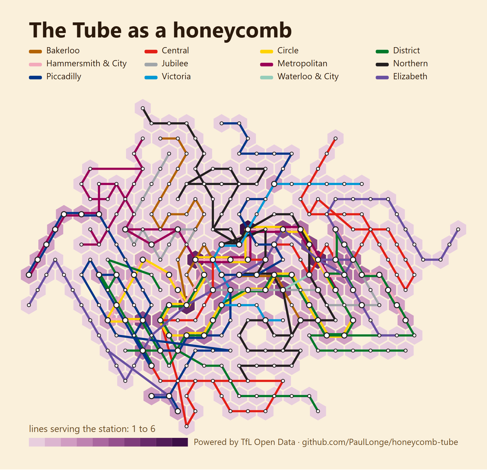
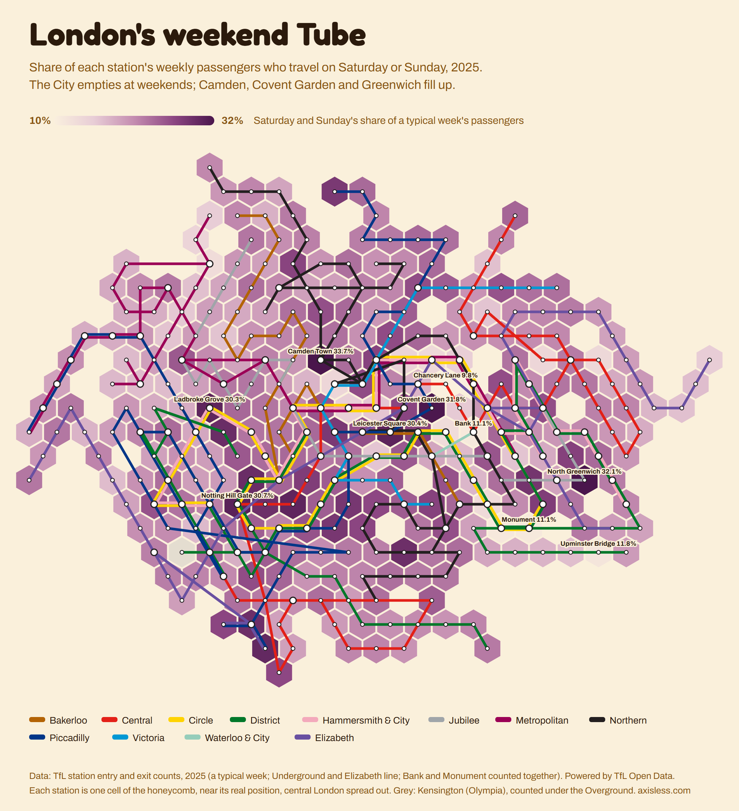

# The Tube as a honeycomb

London's Underground and Elizabeth line redrawn as a honeycomb: **one hexagon per station**, each near where the
station really is, with the lines running through the cells. Because every station is a cell of the same size, you
can colour the map by any number (passengers, house prices, pubs nearby) and every station gets the same space,
from Bank to Epping.



It went up on r/dataisbeautiful as *London's weekend Tube*: each station coloured by the share of its passengers
who travel at the weekend. The City empties; Camden, Covent Garden and North Greenwich fill up.



Explore it with 13 layers (passengers, working-from-home Fridays, house prices, pubs within a kilometre and more) at
**[axisless.com/visualisations/tube](https://axisless.com/visualisations/tube/)**, and play it as a daily puzzle in
[Shade](https://axisless.com/shade/).

## How it works

1. **Fetch the network** (`fetch_network.py`): every line's route from the TfL Unified API. Interchanges become one
   station, links are consecutive stops. 299 stations, 351 links.
2. **Project** each station onto a plane centred on Charing Cross, stretched east-west (London is wider than tall)
   and fisheyed, so zone 1 gets room and the long branches are pulled in.
3. **Snap** stations to the nearest free hex cell, from the centre outwards.
4. **Anneal** (`layout.py`): move stations one at a time, or swap two, accepting worse moves early and fewer later.
   The cost it minimises adds four things:

   | Weight | Wants |
   |---|---|
   | `--edge` | linked stations in touching cells |
   | `--pos` | each station near where it really is |
   | `--turn` | lines running straight through stations |
   | `--dir` | links pointing the way they really go |

   The published map is `--seed 3 --edge 4 --pos 1.2 --turn 2.0 --dir 10`. Without the direction term the map is
   straighter but folds: the Elizabeth line ends up running Taplow, Maidenhead, Twyford, Reading from west to east.
   With it, only 5 of 351 links point against the real geography.
5. **Draw** (`render.py`): an SVG of the cells, lines and stations.

## Use it

```sh
python fetch_network.py            # optional: data/network.json is included
python layout.py                   # optional: data/cells.json is included (takes a few minutes)
python render.py                   # docs/honeycomb.svg, shaded by lines per station
python render.py my_values.json --title "Something per station"
```

`my_values.json` is `{"station id": number}`, using the TfL hub ids in `data/network.json`. Python 3 standard
library only.

The two data files are all you need to draw the map anywhere else: `data/cells.json` gives each station's hex in
axial coordinates `[q, r]` (centre at `x = √3·(q + r/2)`, `y = 1.5·r`), and `data/network.json` gives names,
positions and which lines join which stations.

## Licence

The code is MIT licensed (see `LICENSE`). The station data comes from Transport for London: **Powered by TfL Open
Data**, reused under TfL's open data terms, which ask you to keep that attribution. The line colours are used only
to tell the lines apart; this is not an official TfL map, and TfL's names and marks belong to TfL.

Made by [Paul Longe](https://github.com/PaulLonge) for [Axisless](https://axisless.com), a site of daily puzzles
and charts built from open data.
